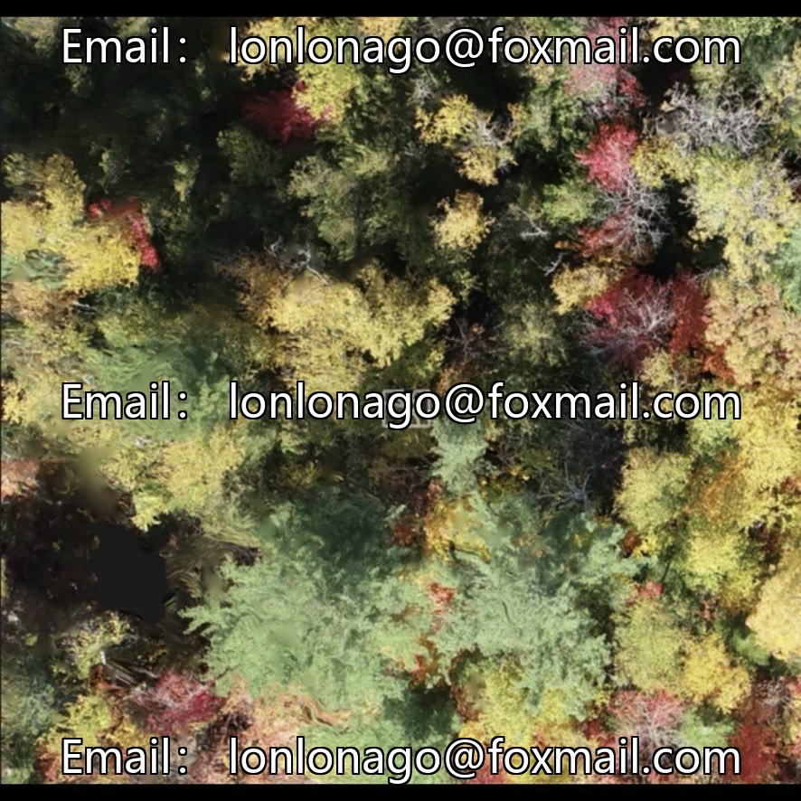
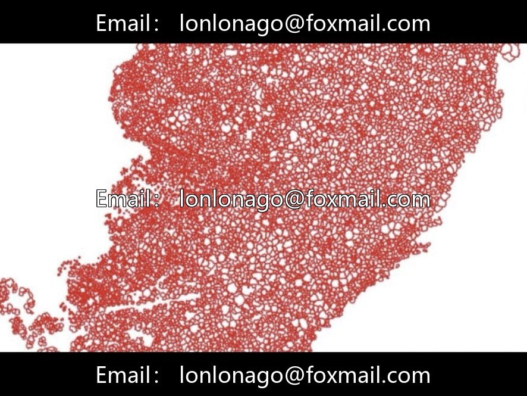
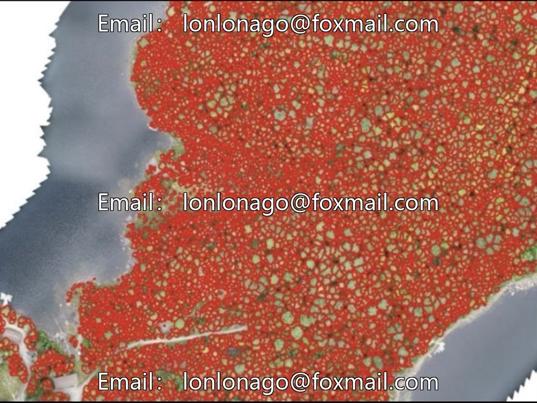
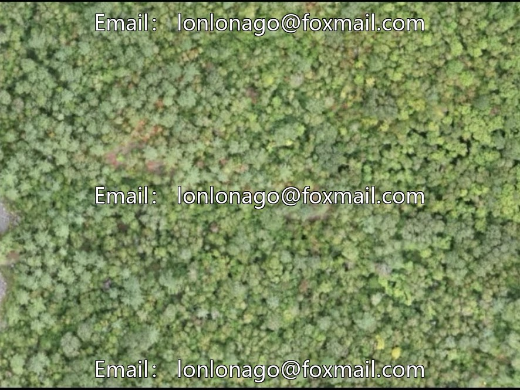

# Drone aerial photography dataset for forest tree segmentation, 10059th remote sensing imagery, including high-resolution.

## Body

Drone aerial photography dataset for forest tree species segmentation, 10059th issue of remote sensing imagery, including high-resolution orthophotos, three-dimensional point clouds, vector data, with a capacity of 149GB. It contains 23,000 crown segmentation annotations for 14 tree species, manually verified, with clear boundaries. Collected by DJI Phantom 4 RTK drone, centimeter-level RTK positioning, data coverage complex forest areas, suitable for tree crown segmentation, species identification, single-tree parameter extraction, three-dimensional modeling, and other forestry AI research.

The dataset supports the training of mainstream segmentation models, enhancing the generalization capability of the model. It is directly used in scenarios such as forestry resource surveys, ecological monitoring, and smart city green management, reducing data preprocessing costs.

Virtual materials, once sold, are non-refundable.
Interested friends, click "I want" to proceed.

## Images

## Payment

Here is a pay link on Stripe ( https://buy.stripe.com/3cs8yP7sY87d0vu9AB ). Please contact me lonlonago@foxmail.com after funding $89, and I will send you a complete data files , thank you!

